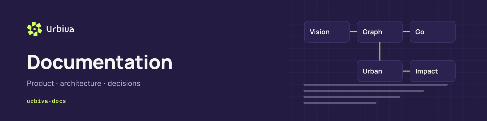
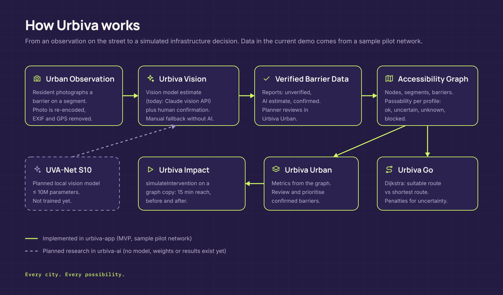

<picture>
  <source media="(prefers-color-scheme: light)" srcset="images/header-urbiva-docs-light.png">
  
</picture>

# urbiva-docs

**Product specifications, architecture decisions, API documentation, and engineering guides for Urbiva.**

Urbiva is AI-powered urban accessibility intelligence: suitable walking routes for people with different mobility needs, AI-assisted barrier reporting with human confirmation, and a graph-based way for planners to see which barrier to remove first.

## Status legend

| Label | Meaning |
| --- | --- |
| **Implemented** | Works in `urbiva-app` today |
| **Sample data** | Works, but runs on the invented "Pilot zona A" network |
| **Planned** | Agreed direction, not built |
| **Research** | Code exists in `urbiva-ai`; no data, weights or results exist |

## Start here

| Topic | Document | Status |
| --- | --- | --- |
| Product overview | [docs/product-overview.md](docs/product-overview.md) | Implemented, sample data |
| System architecture | [docs/architecture.md](docs/architecture.md) | Implemented |
| Urbiva Go | [docs/modules/go.md](docs/modules/go.md) | Implemented |
| Urbiva Vision | [docs/modules/vision.md](docs/modules/vision.md) | Implemented |
| Urbiva Urban | [docs/modules/urban.md](docs/modules/urban.md) | Implemented |
| Urbiva Impact | [docs/modules/impact.md](docs/modules/impact.md) | Implemented |
| Routing engine | [docs/routing-engine.md](docs/routing-engine.md) | Implemented |
| Vision integration and API | [docs/vision-integration.md](docs/vision-integration.md) | Implemented |
| Impact simulation | [docs/impact-simulation.md](docs/impact-simulation.md) | Implemented |
| Data and privacy | [docs/data-privacy.md](docs/data-privacy.md) | Implemented and planned |
| Development setup | [docs/development-setup.md](docs/development-setup.md) | Implemented |
| Architecture decisions | [docs/adr/](docs/adr/) | Accepted |
| AI research | [docs/ai-research.md](docs/ai-research.md) | Implemented in code, not trained |
| Roadmap | [docs/roadmap.md](docs/roadmap.md) | Planned |

## Architecture at a glance

<picture>
  <source media="(prefers-color-scheme: light)" srcset="images/urbiva-architecture-light.png">
  
</picture>

## Urbiva repositories

| Repository | Purpose |
| --- | --- |
| [`urbiva-app`](https://github.com/urbiva/urbiva-app) | Application: Go, Vision, Urban and Impact |
| [`urbiva-ai`](https://github.com/urbiva/urbiva-ai) | Research setup for UVA-Net S10, a planned local vision model |
| [`urbiva-brand`](https://github.com/urbiva/urbiva-brand) | Logo package, tokens, guidelines and GitHub brand kit |
| **urbiva-docs** | Product specifications, architecture, decisions and roadmap |

## Contributing

Documentation changes go through pull requests on `docs/*` branches. Keep the status labels honest: describe what exists, not what we hope to build.

## License

Copyright (c) 2026 the members of the team "Maximilian". All rights reserved.

This repository is public so that it can be read. It is **not open source**. Use, copying, modification, distribution and training of AI systems on it are not permitted except as stated in the [Urbiva Proprietary License 1.0](LICENSE). Third-party components are listed in [NOTICE](NOTICE).
