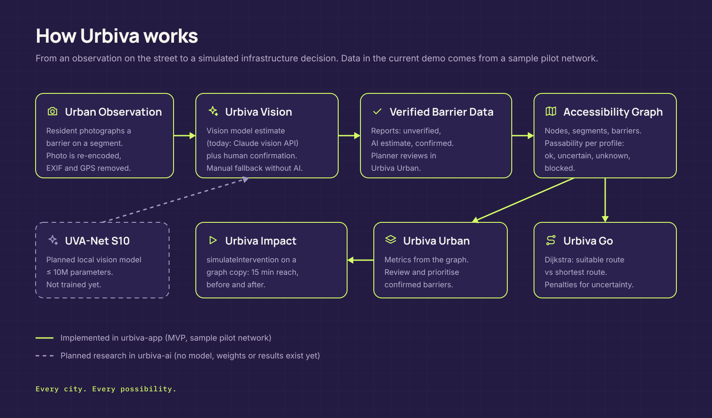

# System architecture

Status: **implemented** (MVP), with planned changes marked.

## Overview

`urbiva-app` is a single Next.js 16 App Router application written in TypeScript with Tailwind CSS 4.

| Layer | Location | Notes |
| --- | --- | --- |
| Routes | `src/app/*/page.tsx` | Thin pages that render module screens |
| Screens | `src/modules/{home,go,vision,urban,impact}` | Client components |
| UI | `src/components` | Logo from master vectors, icons, pilot map, primitives, shells, demo guide |
| Engine | `src/lib/engine` | Graph types, routing, reachability, metrics, scenario state; pure TypeScript, runs in the browser |
| State | `src/lib/store.tsx` | React reducer persisted to `localStorage` (`urbiva-demo-v1`) |
| Vision | `src/lib/vision`, `src/app/api/vision/route.ts` | Browser image preparation; server route that calls the vision model |
| Data | `src/data/pilot-network.ts` | Sample network and assumptions |

## Data flow

1. **Observation.** A resident takes or picks a photo. The browser re-encodes it to JPEG (long side at most 1280 px), which removes EXIF and GPS metadata.
2. **Vision.** `POST /api/vision` validates the image and asks the vision model for a category estimate. The person confirms or corrects it. Without a key, the person classifies manually.
3. **Verified barrier data.** The report is stored as `unverified`. A planner can confirm or reject it in Urban.
4. **Accessibility graph.** Each segment gets a passability state per profile: `ok`, `uncertain`, `unknown` or `blocked`.
5. **Go and Urban.** Go computes routes; Urban computes metrics and shows the review queue.
6. **Impact.** `simulateIntervention` removes a confirmed barrier on a copy of the graph and compares 15-minute reachability before and after.

## Planned changes

| Change | Status |
| --- | --- |
| Server-side storage with access control for reports and reviews | Planned |
| Real network from licensed OpenStreetMap data plus field surveys | Planned |
| Local vision model (UVA-Net S10) behind the same `/api/vision` contract | Code implemented in `urbiva-ai`; not trained |
| Light theme in the app (exists in the design system) | Planned |
